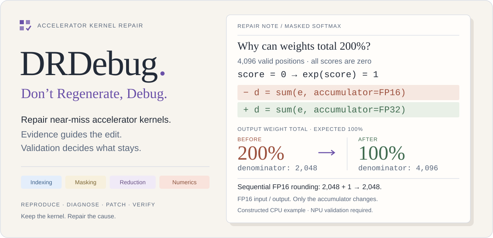
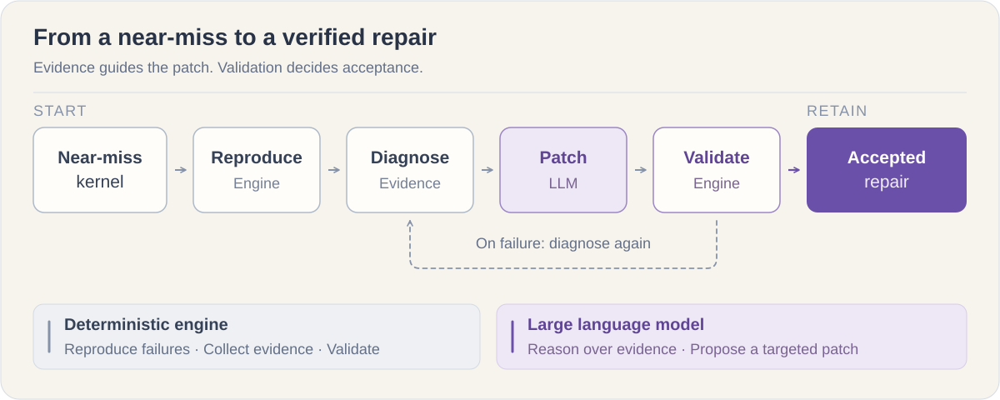

<p align="center">
  <picture>
    <source media="(prefers-color-scheme: dark)" srcset="assets/readme/hero-dark.svg">
    
  </picture>
</p>

<p align="center"><strong>A domain-specific agent for repairing near-miss accelerator kernels.</strong></p>

<p align="center">
  <a href="https://shenxiu-wu.github.io/DRDebug/"></a>
  <a href="#install-the-skill"></a>
  <a href="https://arxiv.org/abs/2608.02712"></a>
  <a href="papers/2026-dont-regenerate-debug/artifact/"></a>
  <a href="papers/2026-dont-regenerate-debug/dataset/"></a>
</p>

<p align="center">
<strong>Yansong Sun</strong><sup>1,*</sup> · <strong>Shenxiu Wu</strong><sup>1,*</sup> · <strong>Siyuan Chen</strong><sup>1</sup> · <strong>Runlin Hou</strong><sup>1</sup> · <strong>Junhao Qiu</strong><sup>1</sup><br>
<strong>Junming Cao</strong><sup>2</sup> · <strong>Shudi Shao</strong><sup>2</sup> · <strong>Zhichao Lu</strong><sup>1,†</sup> · <strong>Qingfu Zhang</strong><sup>1,†</sup>
</p>

<p align="center">
<sup>1</sup> Department of Computer Science, City University of Hong Kong<br>
<sup>2</sup> Application Software Engineering Lab, Huawei Technologies Ltd.
</p>

<p align="center"><sup>*</sup> Equal contribution · <sup>†</sup> Corresponding authors</p>

<p align="center">
  <strong>English</strong> · <a href="README.zh-CN.md">简体中文</a> &nbsp; | &nbsp;
  <a href="#install-the-skill">Install</a> · <a href="#how-it-works">Method</a> · <a href="#research">Research</a> · <a href="#cannbench-results">CANNBench</a> · <a href="#reproduce">Reproduce</a>
</p>

DRDebug starts with a kernel that nearly works. It uses failure evidence to repair the existing implementation, with deterministic validation deciding whether a change is accepted. This repository brings together the papers, released artifacts and public results of the DRDebug research series.

| Start here | What you will find |
| --- | --- |
| [Project website](https://shenxiu-wu.github.io/DRDebug/) | An illustrated repair example, system overview and interactive results |
| [Install the skill](#install-the-skill) | A self-contained paper-edition repair engine for Claude Code or Codex |
| [Paper and method](#research) | The precision-repair study, frozen source and experiment records |
| [Try the Cumsum example](examples/cumsum/README.md) | Verify a saved repaired kernel, or run guided Kimi repair with its public reference |
| [Reproduce and inspect](#reproduce) | CPU table reproduction and verification of the paper’s task data |

## How it works

The **large language model proposes a targeted patch**. The **deterministic engine** reproduces failures, gathers diagnostic evidence and checks the result against the reference. Checkpoints and bounded repair attempts preserve progress throughout the loop.

<p align="center">
  <picture>
    <source media="(prefers-color-scheme: dark)" srcset="assets/readme/repair-loop-dark.svg">
    
  </picture>
</p>

Acceptance requires full numerical testing and an integrity check. Explore the [released method source](papers/2026-dont-regenerate-debug/artifact/code/debug_agent_v5/README_RELEASE.md) or the [paper’s detailed architecture](website/assets/research/architecture-overview.svg).

## Install the skill

**One skill, the paper’s repair loop.** [`drdebug`](skills/drdebug/SKILL.md) brings the deterministic engine, diagnostic tools, full validation, checkpoint/rollback and a public precision-knowledge seed into your agent’s workflow. Installation also includes ten historical reference examples (seven with AscendC kernels).

```bash
git clone https://github.com/Shenxiu-WU/DRDebug.git
cd DRDebug
./install.sh --codex    # or: ./install.sh --claude
```

The installer copies a self-contained skill to `~/.agents/skills/drdebug` (Codex) or `~/.claude/skills/drdebug` (Claude Code). It bundles the public paper runtime, so the installed skill keeps working if you move the checkout. Use `--project /path/to/project` for a project install, `--dest DIR` for a custom skill parent, or `--dry-run` to inspect the destination. Existing installations are preserved; `--force` updates with a backup.

Then ask your agent:

> Use drdebug to check my Ascend environment, prepare a separate workspace for this failing kernel, and repair it from the failure evidence.

**Installation needs Python 3.10+ and no Python packages.** Actual repairs need a user-supplied AscendC task, Linux + Ascend NPU, compatible CANN/AscendC and PyTorch/torch_npu, and an authenticated Claude Code worker. Codex can guide and launch the skill; the paper engine still uses its Claude Code backend. The installer does not install drivers or configure model access.

Start with `doctor`, then `prepare → run → status → verify`. New workspaces explicitly record their deterministic mode; preflight checks ABI/NumPy/device compatibility, and completed full-case evidence participates in best-checkpoint selection without changing the frozen paper archive. [Installation & first repair guide](docs/skill-guide.md) · [Skill instructions](skills/drdebug/SKILL.md) · [What the public adapter changes](skills/drdebug/references/runtime.md).

### Try Cumsum

The [Cumsum example](examples/cumsum/README.md) contains hash-pinned repaired native sources and the original paper input. Choose **saved-candidate replay** without a model, or **guided live repair** with your configured Kimi worker and the published repaired implementation supplied separately as a read-only reference. Both retain the original **10 compact + 51 full cases** and precision thresholds.

Verified on **Ascend910B4 / CANN 9.1.0 / Torch 2.9.0+cpu / torch_npu 2.9.0.post6**, with determinism on:

| Check | Compact | Full | Fresh full-case processes |
| --- | ---: | ---: | ---: |
| Saved candidate with the added nonfinite guard | **10/10** | **51/51** | **51/51** |
| Guided Kimi repair from the original **6/10** baseline | **10/10** | **51/51** | **51/51** |
| Latest adapter: default baseline acceptance, zero worker calls | **10/10** | **51/51** | Covered separately above |

Guided repair used one attempt and **38 turns**: **6 min 25 sec** of worker execution, **15 min 5 sec** including baseline and engine checks. It ran before the added guard; that guard was then independently verified on the identical repaired source. The initial replay used freshly installed isolated dependencies; guided repair and guard checks reused that environment with new installations/workspaces. See the [validation record](examples/cumsum/validation.md) for exact version and source identities. Live repair uses the separately supplied public reference, may incur model charges and does not guarantee the same outcome every time.

## Research

### Don’t Regenerate, Debug

*A Domain-Specific Agent for Repairing Near-Miss Accelerator Kernels* · 2026

[Read the paper](https://arxiv.org/abs/2608.02712) · [PDF](https://arxiv.org/pdf/2608.02712) · [Code & results](papers/2026-dont-regenerate-debug/artifact/) · [Tasks & cases](papers/2026-dont-regenerate-debug/dataset/) · [Initial kernels & wrappers](papers/2026-dont-regenerate-debug/artifact/inputs/)

A controlled study on **27 frozen near-miss operators** from [NPUKernelBench](https://github.com/weich97/NPUKernelBench/tree/master), using `Qwen3.8-max-preview`:

| Measure | Regenerate · three fresh trials | Debug · one continuous task |
| --- | ---: | ---: |
| Successful operators | 11 / 27 · 40.7% | **18 / 27 · 66.7%** |
| Total tokens per successful operator | 397.50M | **28.44M** |

**92.8% fewer tokens per successful operator.** Token totals include unsuccessful runs and cache creation/read tokens, divided by the number of successful operators. M means million tokens; one debugging task may contain several repair rounds.

Sources: [Debug outcomes](papers/2026-dont-regenerate-debug/artifact/results/rq1_rq2_debug_agent_qwen_27.csv) · [Regenerate outcomes](papers/2026-dont-regenerate-debug/artifact/results/rq1_rq2_regenerate_qwen_81.csv) · [Token accounting](papers/2026-dont-regenerate-debug/artifact/results/token_accounting_summary.json).

## CANNBench results

The repair approach also carries forward to a broader community benchmark, with standard and hidden tests. These results are reported separately from the paper’s NPUKernelBench experiment.

**Snapshot: 15 October 2026** · Official-Tasks 1.1 (package 1.1.2) · A3 / Ascend 910C · standard + hidden tests.

| Scope | Test cases passed | Pass rate | Rank by passed cases |
| --- | ---: | ---: | ---: |
| All 53 operators | **5,278 / 5,300** | **99.58%** | **#1** |
| Level 4 · eight hardest tasks | **799 / 800** | **99.88%** | **#1** |

**Seven of the eight Level 4 operators pass every test.** The remaining operator has one failing case across its 100 standard and hidden tests.

The official aggregate is **Debug-Agent Claude Code Kimi K3**. Passed-case rankings cover 170 public aggregates in this snapshot. Pass-rate comparisons use complete test coverage (15 solutions overall; 19 at Level 4); the aggregate also ranks first in both.

[Official leaderboard](https://cannbench.com/leaderboard/official-tasks) · [Dated data & scope](website/data/leaderboard-2026-10-15.json) · [Interactive breakdown](https://shenxiu-wu.github.io/DRDebug/#results)

## Reproduce

**Python 3.10+ · standard library only** for the checks below. Run from the repository root:

```bash
git clone https://github.com/Shenxiu-WU/DRDebug.git
cd DRDebug
python3 -B tools/reproduce_paper.py
python3 -B papers/2026-dont-regenerate-debug/dataset/verify_dataset.py
python3 -B tools/verify_paper_inputs.py
```

- **Paper tables:** validates the frozen artifact and recomputes statistics in a temporary copy. Outputs are saved to `reproduced/tables.md`, `summary.json` and the accompanying analysis files. For another run, choose a fresh directory with `--output PATH`.
- **Initial candidate sources:** verifies all 289 original files across 27 tasks against historical hashes, including 181 kernel files; checks syntax and cases without importing task code.
- **Task data:** verifies 27 reference implementations, 347 compact and 1,134 full input-case specifications against the frozen manifests. This check reads the files without executing the operators.

<details>
<summary>Release contents and execution requirements</summary>

The public release supports CPU statistical reproduction, method-source inspection and task-data verification, and now includes 27 byte-verified initial candidate projects plus historical reference examples. Numerical re-execution still requires a compatible runtime and configured model worker; see the artifact’s [known limitations](papers/2026-dont-regenerate-debug/artifact/KNOWN_LIMITATIONS.md).

The separate [dataset companion](papers/2026-dont-regenerate-debug/dataset/README.md) supplies reference code and input specifications. All 81 reference/case files now match their historical frozen byte hashes, with provenance and dependency records. Executing references may require PyTorch, `torch_npu` and compatible Ascend hardware.

</details>

<details>
<summary>Run the precision illustration or preview the website</summary>

Reproduce the banner’s constructed FP16 rounding example on a CPU:

```bash
python3 -B website/examples/fp16-reduction-demo.py
```

The six constructed checks improve from 3/6 to 6/6. This illustrates the numerical cause and patch; real kernel acceptance still uses full device validation.

Preview the bilingual website, with light and dark themes:

```bash
python3 -m http.server 8000 --directory website
```

Open <http://localhost:8000>. Website source is maintained directly in [`website/`](website/README.md).

</details>

## Repository guide

| Path | Contents |
| --- | --- |
| [`papers/2026-dont-regenerate-debug/artifact/`](papers/2026-dont-regenerate-debug/artifact/) | Frozen method code, experiment records and analysis scripts |
| [`papers/2026-dont-regenerate-debug/dataset/`](papers/2026-dont-regenerate-debug/dataset/) | Reference implementations, input cases, provenance and verification |
| [`skills/drdebug/`](skills/drdebug/) | Installable skill, portable launcher and task contract |
| [`examples/cumsum/`](examples/cumsum/) | Saved-candidate precision replay and a separate live repair walkthrough |
| [`tools/`](tools/) | CPU reproduction entry point |
| [`website/`](website/) | The project website and dated CANNBench snapshot |

Each paper has its own directory under `papers/`. Published paper versions retain their release tags. Restored source materials are documented in the artifact’s public release changes; website and skill updates are maintained alongside them.

## Citation

```bibtex
@misc{sun2026dontregeneratedebug,
  title={Don't Regenerate, Debug: A Domain-Specific Agent for Repairing Near-Miss Accelerator Kernels},
  author={Yansong Sun and Shenxiu Wu and Siyuan Chen and Runlin Hou and Junhao Qiu and Junming Cao and Shudi Shao and Zhichao Lu and Qingfu Zhang},
  year={2026},
  eprint={2608.02712},
  archivePrefix={arXiv},
  primaryClass={cs.SE},
  url={https://arxiv.org/abs/2608.02712}
}
```

## License

Project-authored code and website assets use the [MIT license](LICENSE). Third-party code, benchmark materials and paper figures retain their own attribution and licensing terms. See [THIRD_PARTY_NOTICES.md](THIRD_PARTY_NOTICES.md) and each artifact’s notices.
